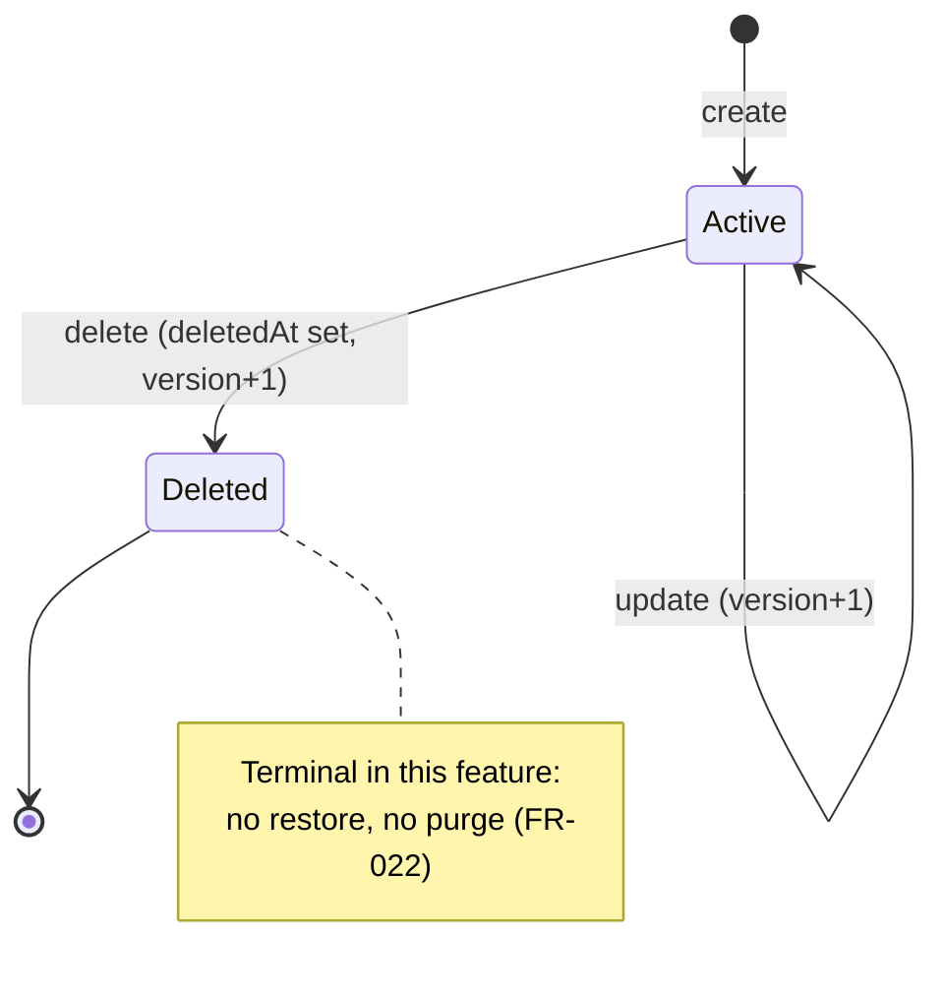

# Data Model: Project Management

**Feature**: `001-project-management` | **Date**: 2026-10-06 | **Plan**: [plan.md](plan.md)

## Entity: Project (aggregate root)

| Field | Domain type | Required | Rules (source) |
|---|---|---|---|
| `id` | UUID | system | Generated by the database; never changes |
| `chargeCode` | `ChargeCode` (8-digit string) | system | `^[0-9]{8}$`, leading zeros kept; generated on create; unique across **all** projects incl. deleted; never changes or reused (FR-010–FR-015) |
| `name` | `ProjectName` | yes | Trimmed; 1–100 chars after trim; unique among non-deleted projects ignoring case (FR-007, FR-008) |
| `projectManager.name` | string | yes | Trimmed; 1–100 chars after trim (FR-023) |
| `projectManager.email` | `EmailAddress` | yes | Trimmed, stored lower-case; valid email per the contract's `format: email` (ajv-formats "fast"); ≤ 254 chars (FR-023, FR-024) |
| `startDate` | `CalendarDate` | yes | Valid date; on create ≥ today; on edit, if changed, ≥ today (FR-006, FR-006a) |
| `endDate` | `CalendarDate` | yes | Valid date; ≥ `startDate`; on edit ≥ currently saved `endDate` (FR-006, FR-006b) |
| `projectType` | enum `INTERNAL` \| `CLIENT` | yes | FR-003 |
| `clientName` | string \| null | conditional | Required (trimmed, 1–100) when `CLIENT`; always `null` when `INTERNAL` — any submitted value is discarded (FR-003a) |
| `billingType` | enum `BILLABLE` \| `NON_BILLABLE` | yes | Any combination with `projectType` (FR-004, FR-005) |
| `version` | integer ≥ 1 | system | Starts at 1; +1 on every update and on delete (FR-020) |
| `createdAt` | timestamp (UTC) | system | Set on create (FR-029) |
| `updatedAt` | timestamp (UTC) | system | Set on create, update, delete (FR-029) |
| `deletedAt` | timestamp (UTC) \| null | system | Set once on delete; never cleared in this feature (FR-021, FR-022) |
| `createRequestId` | UUID | system | Idempotency key from the create request; unique (FR-009); not exposed in responses |

**Display labels** (UI only): `INTERNAL` → "Internal Project", `CLIENT` → "Client Project",
`BILLABLE` → "Billable", `NON_BILLABLE` → "Non-Billable".

### Value objects

- **`ChargeCode`** — wraps an 8-character digit string; constructed only by the backend generator
  or from storage. Never parsed as a number. Immutable: no domain operation or `UPDATE`
  statement changes it.
- **`ProjectName`** — trims input; rejects blank or > 100 characters.
- **`EmailAddress`** — trims and lower-cases; validates with the same pattern the API contract's
  `format: email` uses (ajv-formats "fast" mode) and length ≤ 254, so the API and the domain
  always agree on what is a valid email.
- **`CalendarDate`** — `YYYY-MM-DD`, validated as a real calendar date (rejects `2026-02-31`);
  comparable.

### Domain behavior

| Operation | Pre-conditions | Effect |
|---|---|---|
| `Project.create(input, today, chargeCode)` | All field rules pass; `startDate ≥ today` | New active project, `version = 1` |
| `project.update(input, today)` | Project active; field rules pass; if `startDate` changed → `≥ today`; `endDate ≥ saved endDate`; `endDate ≥ startDate` | Fields replaced (except `chargeCode`); `CLIENT→INTERNAL` clears `clientName`; `version + 1` |
| `project.delete(now)` | Project active | `deletedAt = now`; `version + 1` |

Validation collects **all** field errors at once (FR-026) and reports them with stable codes:

| Code | Field(s) | Meaning |
|---|---|---|
| `REQUIRED` | any | Missing or blank after trim |
| `TOO_LONG` | `name`, `clientName`, `projectManager.name`, `projectManager.email` | Over limit |
| `INVALID_EMAIL` | `projectManager.email` | Not a valid email format |
| `INVALID_DATE` | `startDate`, `endDate` | Not a real calendar date |
| `START_DATE_IN_PAST` | `startDate` | Earlier than today (create, or changed on edit) |
| `END_BEFORE_START` | `endDate` | Earlier than `startDate` |
| `END_DATE_SHORTENED` | `endDate` | Earlier than currently saved `endDate` (edit) |
| `CLIENT_NAME_REQUIRED` | `clientName` | Missing for `CLIENT` projects |

Other domain/application errors: `PROJECT_NOT_FOUND`, `PROJECT_NAME_TAKEN`, `VERSION_CONFLICT`,
`CHARGE_CODE_UNAVAILABLE`. HTTP mapping is defined in [contracts/openapi.yaml](contracts/openapi.yaml).

## State transitions

## Persistence: table `project`

| Column | Type | Constraint |
|---|---|---|
| `id` | `uuid` | `PRIMARY KEY DEFAULT gen_random_uuid()` |
| `charge_code` | `char(8)` | `NOT NULL`, `UNIQUE` (`project_charge_code_uq`), `CHECK (charge_code ~ '^[0-9]{8}$')` |
| `name` | `varchar(100)` | `NOT NULL`, `CHECK (name = btrim(name) AND name <> '')` |
| `project_manager_name` | `varchar(100)` | `NOT NULL`, `CHECK (project_manager_name = btrim(project_manager_name) AND project_manager_name <> '')` |
| `project_manager_email` | `varchar(254)` | `NOT NULL`, `CHECK (project_manager_email = lower(btrim(project_manager_email)))` |
| `start_date` | `date` | `NOT NULL` |
| `end_date` | `date` | `NOT NULL`, `CHECK (end_date >= start_date)` |
| `project_type` | `varchar(16)` | `NOT NULL`, `CHECK (project_type IN ('INTERNAL','CLIENT'))` |
| `client_name` | `varchar(100)` | `NULL`; `CHECK ((project_type = 'CLIENT' AND client_name IS NOT NULL AND client_name = btrim(client_name) AND client_name <> '') OR (project_type = 'INTERNAL' AND client_name IS NULL))` |
| `billing_type` | `varchar(16)` | `NOT NULL`, `CHECK (billing_type IN ('BILLABLE','NON_BILLABLE'))` |
| `create_request_id` | `uuid` | `NOT NULL`, `UNIQUE` (`project_create_request_id_uq`) |
| `version` | `integer` | `NOT NULL DEFAULT 1`, `CHECK (version >= 1)` |
| `created_at` | `timestamptz` | `NOT NULL DEFAULT now()` |
| `updated_at` | `timestamptz` | `NOT NULL DEFAULT now()` |
| `deleted_at` | `timestamptz` | `NULL` |

**Indexes**

| Name | Definition | Purpose |
|---|---|---|
| `project_name_active_uq` | `UNIQUE (lower(name)) WHERE deleted_at IS NULL` | FR-008 under concurrency |
| `project_active_start_date_idx` | `(start_date) WHERE deleted_at IS NULL` | Sort by start date |
| `project_active_end_date_idx` | `(end_date) WHERE deleted_at IS NULL` | Sort by end date |

Constraint names are stable because the repository maps unique violations by constraint name:
`project_name_active_uq` → `PROJECT_NAME_TAKEN`; `project_charge_code_uq` → retry generation;
`project_create_request_id_uq` → idempotent replay.

Time-dependent rules (`startDate ≥ today`, `endDate` not shortened) are **domain-only**; they
cannot be database constraints because they depend on the current date and the previous value.

**Migration**: `0001_create_project.sql` (forward-only). Requires PostgreSQL ≥ 13 for
`gen_random_uuid()` without an extension (target: 16).

## Query semantics

- **List/search** (non-deleted only): optional `search` term, trimmed, LIKE wildcards escaped,
  matched case-insensitively as a substring (`ILIKE '%term%'`) against `name`, `charge_code`,
  `project_manager_name`, `project_manager_email`, `client_name` (FR-017).
- **Sort**: `name` (by `lower(name)`), `chargeCode`, `startDate`, `endDate`; `asc`/`desc`;
  tie-breaker `id` for stable paging.
- **Paging**: `LIMIT/OFFSET` with `COUNT(*) OVER()` for `totalItems` — adequate for ≤ 100k rows.

## Future-compatibility notes

- Identity: add nullable `created_by`, `updated_by` and a `project_manager_user_id` resolved by
  matching `project_manager_email` (FR-024) — additive migrations.
- Audit trail: new `project_audit_entry` table written by the same use cases inside the existing
  transactions — no change to the `project` table required.
